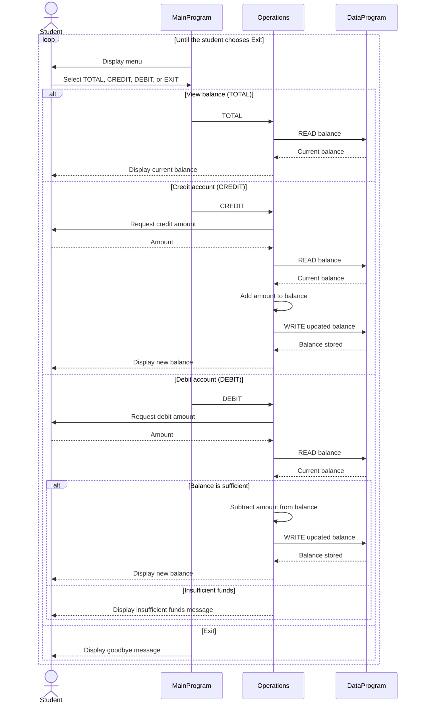

# Student Account COBOL Components

This directory documents the COBOL account-management example in `src/cobol`. The program models a single student account with an in-memory balance and an interactive console menu.

## File Overview

### `src/cobol/main.cob`

`MainProgram` is the user-facing entry point. It:

- Displays the account-management menu.
- Accepts a choice from 1 through 4.
- Dispatches account actions to the `Operations` program:
  - `1` sends `TOTAL ` to view the current balance.
  - `2` sends `CREDIT` to add money.
  - `3` sends `DEBIT ` to subtract money.
- Continues until the user selects `4`, then stops the run.
- Displays an error for any choice outside 1 through 4.

### `src/cobol/operations.cob`

`Operations` contains the account business actions. It receives a six-character operation code and handles:

- `TOTAL `: Reads the stored balance and displays it.
- `CREDIT`: Reads an amount, adds it to the current balance, writes the result, and displays the new balance.
- `DEBIT `: Reads an amount, checks the available balance, subtracts the amount when permitted, writes the result, and displays the new balance.

This program is the main business-logic layer and calls `DataProgram` for all balance reads and writes.

### `src/cobol/data.cob`

`DataProgram` provides the balance storage interface. It exposes a balance through the linkage section and supports two six-character operations:

- `READ`: Copies the stored balance into the caller's balance field.
- `WRITE`: Replaces the stored balance with the caller's balance field.

The stored balance is initialized to `1000.00` and is held in working storage for the life of the program run.

## Student Account Business Rules

1. The account starts with a balance of `1000.00` for each program run.
2. A credit increases the current balance by the entered amount.
3. A debit is allowed only when the current balance is greater than or equal to the entered amount.
4. A debit that exceeds the current balance is rejected and leaves the balance unchanged; the program displays `Insufficient funds for this debit.`
5. Successful credits and debits are written back through `DataProgram` before the new balance is displayed.
6. The account balance uses a six-digit whole-number field with two decimal places (`PIC 9(6)V99`), so the represented maximum is `999999.99`.
7. The current implementation does not validate zero or negative input amounts, enforce a maximum balance, identify individual students, or persist data after the run ends. These are important considerations for a production student-account system.
8. Operation codes are fixed-width six-character values, including the trailing spaces in `TOTAL ` and `DEBIT `.

## Runtime Flow

```text
MainProgram
    -> Operations (TOTAL / CREDIT / DEBIT)
        -> DataProgram (READ balance)
        -> DataProgram (WRITE balance when changed)
```

## Sequence Diagram


